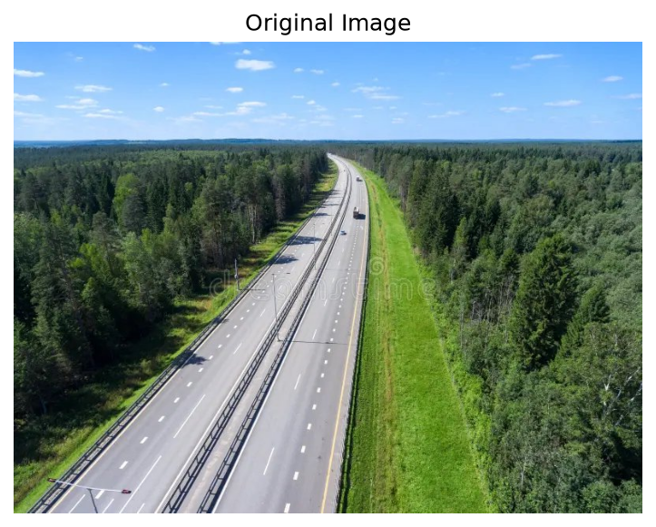
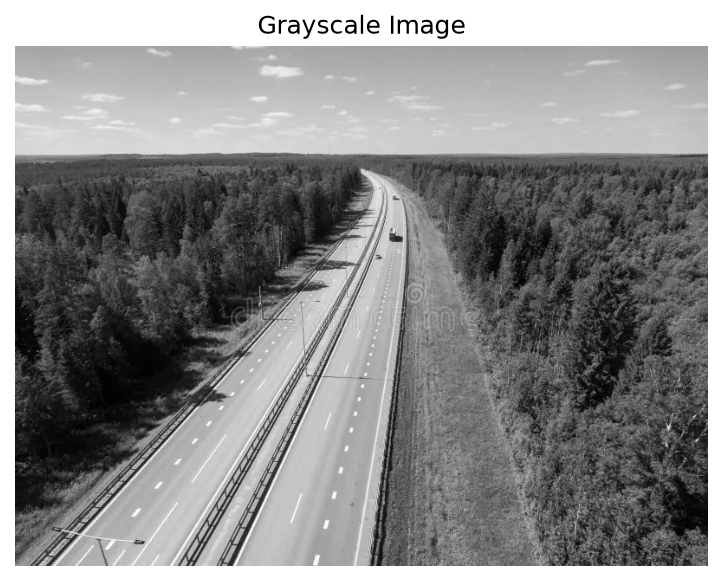
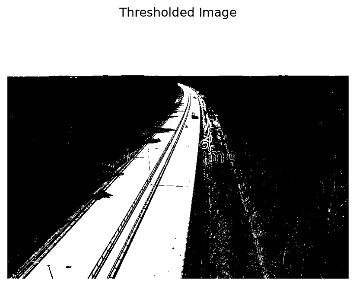
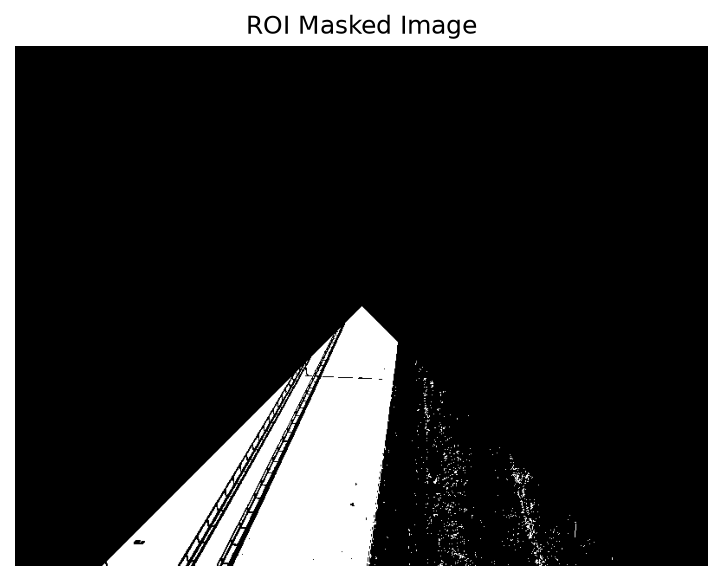
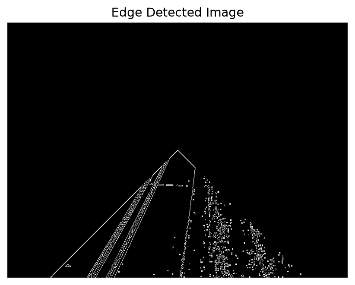
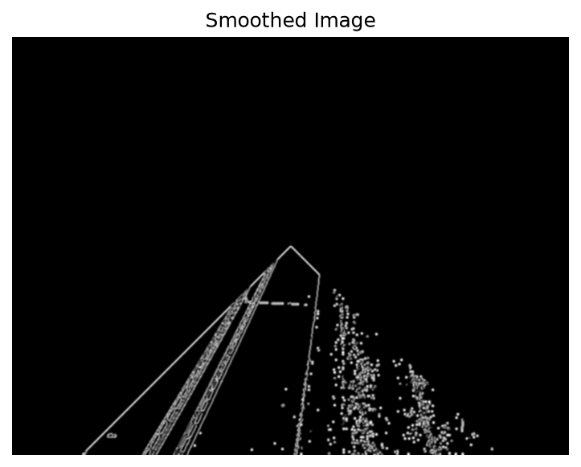
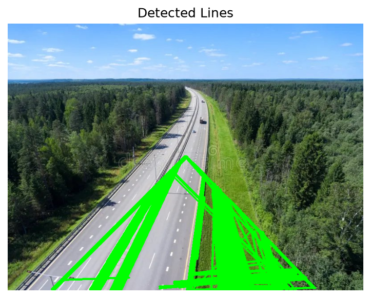
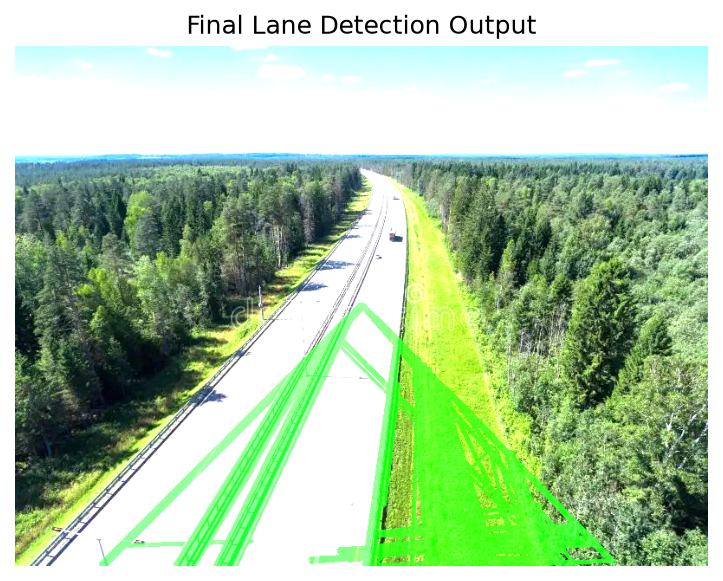

#  Lane Detection

##  Aim

To implement a basic lane detection pipeline using OpenCV by completing missing code segments at specified locations.

---

## Learning Objective

* Understand each stage of image processing
* Learn how to build a complete computer vision pipeline
* Practice writing code in guided sections

**Important Instruction:**
👉 Write code **ONLY in places marked as `# Your Code Here`**
👉 Do NOT modify any other part of the code

---

##  Software Used

* Anaconda – Python 3.7
* Jupyter Notebook / VS Code
* OpenCV (cv2)
* NumPy
* Matplotlib

---

##  Algorithm & Explanation

---

###  Step 1: Import Libraries

```python
import cv2
import numpy as np
import matplotlib.pyplot as plt
```

---

###  Step 2: Read the Image

```python
# Read the image using OpenCV

###
# Your Code Here
img = cv2.imread(r"C:\Users\acer\Desktop\road.jpeg")
if img is None:
    print("Image not found. Check path.")
else:
    print("Image loaded successfully.")

###
```

---

###  Step 3: Convert to Grayscale

```python
# Convert to grayscale.

###
# Your Code Here
gray = cv2.cvtColor(img, cv2.COLOR_BGR2GRAY)

###
```

---

###  Step 4: Display Images

```python
plt.figure(figsize=(10,5))

###
# Your Code Here
plt.figure(figsize=(10,5))
plt.subplot(1,2,1), plt.imshow(cv2.cvtColor(img, cv2.COLOR_BGR2RGB)), plt.title("Original Image"), plt.axis("off")
plt.subplot(1,2,2), plt.imshow(gray, cmap='gray'), plt.title("Grayscale Image"), plt.axis("off")
plt.show()

###
```

---

###  Step 5: Thresholding

```python
# Apply thresholding

threshold = 
###
# Your Code Here

_, threshold = cv2.threshold(gray, 150, 255, cv2.THRESH_BINARY)
plt.imshow(threshold, cmap='gray')
plt.title("Thresholded Image")
plt.axis("off")
plt.show()
###
```

---

###  Step 6: Region of Interest (ROI)

```python
# ROI masking already provided
# (Do not modify)

mask = np.zeros_like(gray)
height, width = gray.shape
roi = np.array([[(100, height), (width-100, height), (width//2, height//2)]])
cv2.fillPoly(mask, roi, 255)
roi_img = cv2.bitwise_and(threshold, mask)

plt.imshow(roi_img, cmap='gray')
plt.title("ROI Masked Image")
plt.axis("off")
plt.show()
```

---

### Step 7: Edge Detection (Canny)

```python
# Perform Edge Detection

###
# Your Code Here
edges = cv2.Canny(roi_img, 50, 150)
plt.imshow(edges, cmap='gray')
plt.title("Edge Detected Image")
plt.axis("off")
plt.show()
###
```

---

###  Step 8: Gaussian Blur

```python
# Apply Gaussian Blur

###
# Your Code Here
blurred = cv2.GaussianBlur(edges, (5,5), 0)
plt.imshow(blurred, cmap='gray')
plt.title("Smoothed Image")
plt.axis("off")
plt.show()
###
```

---

###  Step 9: Hough Transform

```python
# Detect lines using Hough Transform

###
# Your Code Here
lines = cv2.HoughLinesP(blurred, 1, np.pi/180, threshold=50, minLineLength=100, maxLineGap=50)
line_img = np.copy(img)

if lines is not None:
    for line in lines:
        # Handle both shapes safely
        if len(line) == 4:
            x1, y1, x2, y2 = line
        else:
            x1, y1, x2, y2 = line[0]
        cv2.line(line_img, (x1, y1), (x2, y2), (0,255,0), 3)
else:
    print("No lines detected. Try adjusting parameters.")

plt.imshow(cv2.cvtColor(line_img, cv2.COLOR_BGR2RGB))
plt.title("Detected Lines")
plt.axis("off")
plt.show()
###
```

---

### Step 10: Lane Detection Logic

```python
# Already implemented
# (Do not modify)

# Step 10: Lane Detection Logic (already implemented in your template)
final_output = cv2.addWeighted(img, 0.8, line_img, 1, 0)
plt.imshow(cv2.cvtColor(final_output, cv2.COLOR_BGR2RGB))
plt.title("Final Lane Detection Output")
plt.axis("off")
plt.show()
```

---

##  Expected Output

* Original image



  
* Grayscale image



* Thresholded image



* ROI masked image



* Edge detected image



* Smoothed image



* Detected lines



* Final lane detection output


 

---

##  Instructions

* Fill ONLY in `# Your Code Here` sections
* Do NOT change existing code
* Run step-by-step
* Verify outputs

---

## Result

Thus, the lane detection pipeline is successfully implemented by completing the missing code sections. The system detects and highlights lane lines effectively.

---

##  Developed By

* **Name:** Subashini K
* **Register No:** 212225240160
